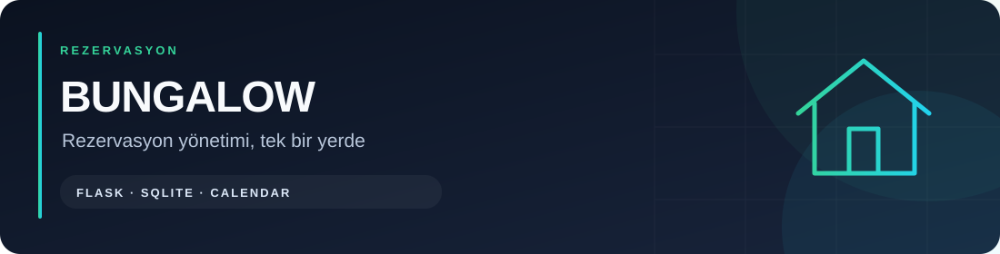
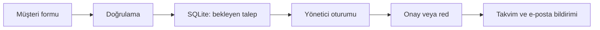

# Bungalow Rezervasyon Sistemi



[](https://github.com/symNistaken/bungalow-reservation-system/actions/workflows/checks.yml)
[](https://www.python.org/downloads/)

[](LICENSE-SCOPE.md)

Flask ve SQLite ile geliştirilmiş bungalov rezervasyon uygulaması. Müşteriler rezervasyon talebi oluşturabilir; yöneticiler talepleri inceleyip onaylayabilir veya reddedebilir.

Bu depo, [CGhost1908/bungalow-reservation-system](https://github.com/CGhost1908/bungalow-reservation-system) projesinin fork'udur. Frontend kökeni ve katkı sahiplerinin hakları korunur; backend ve yönetim panelindeki Berkay Seyman katkıları aşağıda açıklanmıştır.

## Özellikler

- Bungalov seçimi, giriş/çıkış tarihleri ve misafir bilgileriyle rezervasyon talebi.
- Yönetici girişi, rezervasyon listesi ve onay/red işlemleri.
- FullCalendar tabanlı yönetici takvimi.
- E-posta, telefon, tarih aralığı ve misafir sayısı kontrolleri.
- Bungalov başına onaylanmış rezervasyonlarla tarih çakışması kontrolü.
- Gmail SMTP üzerinden yönetici ve müşteri bildirimleri.
- SQLite saklama, eski JSON kayıtları için taşıma yardımcıları ve loglama.

> Yerel çalışma için şifreyi kendin ayarla. Üretim modu eksik oturum anahtarı, zayıf varsayılan şifre ve paylaşımsız istek sınırı yapılandırmasını reddeder.

## Akış



## Kurulum

Python 3.10 ve Git ile yerel çalışma için:

```bash
git clone https://github.com/symNistaken/bungalow-reservation-system.git
cd bungalow-reservation-system
python -m venv .venv
```

Windows PowerShell:

```powershell
.\.venv\Scripts\python.exe -m pip install -r requirements.txt
Copy-Item .env.example .env
```

Linux/macOS:

```bash
.venv/bin/python -m pip install -r requirements.txt
cp .env.example .env
```

`.env` dosyasına yönetici ve oturum ayarlarını ekle; e-posta şablonundaki yer tutucuları kendi bilgilerinle değiştir:

```dotenv
SECRET_KEY=YOUR_RANDOM_SECRET_KEY
ADMIN_USERNAME=YOUR_ADMIN_USERNAME
ADMIN_PASSWORD=YOUR_STRONG_ADMIN_PASSWORD
TIMEZONE=Europe/Istanbul
EMAIL_SENDER=YOUR_GMAIL_ADDRESS
EMAIL_PASSWORD=YOUR_GMAIL_APP_PASSWORD
ADMIN_EMAIL=YOUR_NOTIFICATION_EMAIL
```

Rastgele oturum anahtarı üretmek için:

```bash
python -c "import secrets; print(secrets.token_hex(32))"
```

Gmail için [iki aşamalı doğrulama](https://support.google.com/accounts/answer/185839) ve [uygulama şifresi](https://myaccount.google.com/apppasswords) kullan. Normal hesap şifreni paylaşma. E-posta ayarları eksikse bildirimler çalışmaz; uygulama terminalde uyarı verir. `SMTP_SERVER` ve `SMTP_PORT` ortam değişkenleri okunur; varsayılan `smtp.gmail.com:587`. SMTP bağlantısında zaman aşımı vardır.

Windows:

```powershell
.\.venv\Scripts\python.exe app.py
```

Linux/macOS:

```bash
.venv/bin/python app.py
```

[http://localhost:5000](http://localhost:5000) adresini aç. Komutları depo kökünde çalıştır; SQLite dosyası ve loglar çalışma dizininde oluşur.

## Kullanım

**Müşteri:** `/reservation` sayfasında ad, e-posta, telefon, bungalov, misafir sayısı ve tarihleri doldur. Talep `pending` durumunda kaydedilir; yönetici kararı sonrasında bildirim gönderilmeye çalışılır.

**Yönetici:** `/admin/login` üzerinden `.env` içinde belirlediğin bilgilerle giriş yap. `/admin` sayfasında talepleri listele, takvimi incele ve onay/red işlemlerini yap.

Yönetici kullanıcı adı varsayılan `admin` olabilir; şifre zorunludur ve `admin123` kabul edilmez. Geliştirmede SECRET_KEY verilmezse her başlangıçta rastgele anahtar üretilir; mevcut oturumlar yeniden başlatmada sona erer.

## Sayfalar ve API

| Yol | Yöntem | Erişim / amaç |
| --- | --- | --- |
| `/`, `/bungalows`, `/gallery` | GET | Genel sayfalar |
| `/reservation` | GET | Rezervasyon formu |
| `/admin/login` | GET, POST | Yönetici girişi |
| `/admin` | GET | Yönetici paneli |
| `/admin/logout` | POST | Yönetici çıkışı; CSRF token gerekli |
| `/api/reservation` | POST | Herkese açık talep oluşturma |
| `/api/reservations` | GET | Yönetici oturumu; tüm kayıtlar |
| `/api/reservations/pending` | GET | Yönetici oturumu; bekleyen kayıtlar |
| `/api/reservations/<id>/approve` | POST | Yönetici oturumu; onay |
| `/api/reservations/<id>/reject` | POST | Yönetici oturumu; red |
| `/api/booked-dates` | GET | Genel doluluk bilgisi; isteğe bağlı `bungalow` query alanı |
| `/api/bungalow-dates/<bungalow>` | GET | Yönetici oturumu; durum ve misafir adları |

Yönetici oturumu gerektiren uç noktalar giriş yapılmamışsa `/admin/login` adresine yönlendirir. Tüm durum değiştiren POST istekleri, aynı oturumdaki sayfada üretilmiş CSRF token gerektirir. HTML sayfalarının `csrf-token` meta alanındaki değeri `X-CSRFToken` başlığında gönder; logout formu gizli `csrf_token` alanını kullanır. Yeni token için sayfayı yenile. `/api/reservation` JSON gövdesinde şu alanları bekler:

```json
{
  "name": "Örnek Misafir",
  "email": "guest@example.com",
  "phone": "05301234567",
  "checkIn": "YYYY-MM-DD",
  "checkOut": "YYYY-MM-DD",
  "guests": 2,
  "bungalow": "Bungalow 1",
  "notes": "İsteğe bağlı not"
}
```

Tarihleri gelecekteki gerçek tarihlerle, bungalov değerini arayüzdeki seçenekle değiştir. Giriş ve çıkış bugünden sonra olmalı; çıkış girişten sonra ve konaklama en fazla 90 gün olmalıdır. Misafir sayısı `1–20` aralığındadır. Doğrulama hataları `400`, onaylı rezervasyon çakışması `409` döndürür.

## Veritabanı ve dosyalar

```text
app.py                 Flask, doğrulama, yönetici oturumu ve bildirimler
database.py            SQLite işlemleri ve JSON taşıma
templates/             Müşteri ve yönetici sayfaları
static/                CSS ve JavaScript
.env.example           E-posta ortam şablonu
requirements.txt       Python paketleri
test_app.py            Doğrulama, veritabanı ve API testleri
test_email.py          Gerçek SMTP bağlantı/bildirim testi
inspect_db.py          Yerel veritabanını inceleme
```

Asıl saklama dosyası **`reservations.db`**; `reservations.json` eski taşıma girdisidir. Veritabanı tabloları başlangıçta oluşturulur. `.env`, veritabanı ve loglar Git dışında tutulur. Rezervasyonlarda müşteri iletişim bilgileri bulunur; paylaşmadan önce veriyi temizle ve yedek al.

`static/images/` ve `static/videos/` Git tarafından yok sayılır; yerel görsel dosyaları klonda bulunmayabilir. Kullanacağın görselleri ilgili yollarına kendin yerleştir. Veritabanı dosyasını veya müşteri kayıtlarını hata raporuna yükleme.

## Kontroller

Paketler kurulduktan sonra, sanal ortamın Python'u ile depo kökünde:

```bash
python -m unittest test_app test_security -v
```

Bu testler doğrulama, SQLite işlemleri ve API davranışlarını kapsar. Test içe aktarması yerel veritabanı/log dosyaları oluşturabilir; canlı veritabanının bulunduğu dizinde çalıştırma. E-posta testini yalnızca kendi hesabın ve alıcılarınla çalıştır:

```bash
python test_email.py
```

E-posta testi SMTP'ye bağlanır ve yapılandırılmış adreslere bildirim gönderebilir; çevrimdışı test değildir.

## Güvenlik ve mevcut sınırlar

- Yönetici listeleri, onay/red uç noktaları ve misafir isimli takvim, yönetici oturumu gerektirir.
- Şifreler Werkzeug ile hash'lenir; rate limiting ve güvenlik başlığı bileşenleri bulunur.
- Flask-WTF CSRF doğrulaması login, rezervasyon, karar ve logout POST isteklerini korur. Token oturuma bağlıdır. Yönetici girişi eski oturum değerlerini temizler; oturum süresi bir saattir.
- Debug varsayılan olarak kapalıdır. Üretimde uygun WSGI sunucusu ve HTTPS kullan; geliştirme sunucusunu internete açma.
- Wildcard CORS kaldırıldı; arayüz aynı origin üzerinde çalışır. Kullanıcı metinleri yönetici kartlarında ve HTML e-postalarda escape edilir.
- Bekleyen talepler aynı tarihlere gelebilir; onay kontrolü SQLite yazma işlemiyle aynı transaction içinde yapılır. Eşzamanlı çakışan onaylardan yalnızca biri kabul edilir. Onay/red yalnızca bekleyen kaydı değiştirir; başka kayıtlar silinmez. JSON taşıma mevcut kayıtları korur.

## Sorun giderme

- **E-posta gitmiyor:** `.env`, Gmail uygulama şifresi, alıcı adresi ve terminal loglarını kontrol et.
- **Yönetici girişi başarısız:** `.env` değerlerini değiştirince sunucuyu yeniden başlat.
- **Görsel eksik:** Şablonun beklediği `static/images/` yolunda dosya bulunduğunu kontrol et.
- **Veri görünmüyor:** Komutları aynı depo kökünden çalıştır; `reservations.db` çalışma dizinine bağlıdır.

## Katkılar ve kullanım koşulları

Frontend kökeni [CGhost1908/bungalow](https://github.com/CGhost1908/bungalow) projesidir. Rezervasyon backend'i, SQLite entegrasyonu ve yönetim paneli **Berkay Seyman** tarafından geliştirilmiştir.

**Berkay Seyman'a ait özgün katkılar [MIT Lisansı](LICENSE) ile yayımlanır.** Bu katkıların ticari kullanımı, değiştirilmesi ve dağıtımı serbesttir; telif ve lisans metni korunmalıdır.

Fork'tan gelen frontend ve diğer geliştiricilerin katkıları yeniden lisanslanmaz. MIT kapsamı ve üçüncü taraf hakları için [lisans kapsamı](LICENSE-SCOPE.md) belgesine bakın.

## İletişim ve ek belgeler

- Berkay Seyman: berkayseyman@gmail.com
- Bilal Berke Ceylan: bilalberkeceylan@gmail.com
- Eren Batı Altunkapak: erenbatialtunkapak@gmail.com

[E-posta kurulumu](EMAIL_SETUP.md), [yönetici kurulumu](ADMIN_SETUP.md) ve [veritabanı inceleme](DATABASE_INSPECTION.md) belgeleri ek geliştirme notlarıdır. Tarihsel notlardaki güvenlik ve üretime hazır olma iddialarını bu README'deki mevcut sınırlarla birlikte değerlendir.
## Otomatik kontroller

[GitHub Actions](https://github.com/symNistaken/bungalow-reservation-system/actions) her push ve pull request için sözdizimi ve uygulama testlerini çalıştırır. Gerçek SMTP gönderimi bu testlerin dışında kalır.

## Üretim yapılandırması

```dotenv
APP_ENV=production
SECRET_KEY=YOUR_RANDOM_32_OR_MORE_CHARACTER_SECRET
ADMIN_PASSWORD=YOUR_STRONG_12_OR_MORE_CHARACTER_PASSWORD
RATELIMIT_STORAGE_URI=redis://localhost:6379/0
```

Redis bağlantısını kendi altyapına göre ayarla. `memory://` üretim modunda kabul edilmez. HTTPS üzerinde oturum çerezi `Secure`, `HttpOnly` ve `SameSite=Lax` kullanır.

Sanal ortam etkinleştirildikten sonra örnek WSGI komutu:

```bash
waitress-serve --listen=127.0.0.1:8000 app:app
```

Bu komut yalnızca yerel WSGI başlatır. HTTPS reverse proxy kurulumu, güvenilir proxy ayarları, Redis erişim kontrolü, yedekleme ve e-posta hesabı gerçek sunucu üzerinde ayrıca yapılandırılmalıdır. HTTPS şemasının uygulamaya yalnızca güvenilir proxy üzerinden aktarılması gerekir; rastgele istemcilerin gönderdiği forwarded başlıklarına güvenme.

`test_app` ve `test_security` birlikte 37 test içerir: CSRF, login/logout, üretim yapılandırmasının reddi, eşzamanlı onay, JSON taşıma ve HTML e-posta escape kontrolleri dahil. Testler gerçek müşterilere e-posta göndermez.
